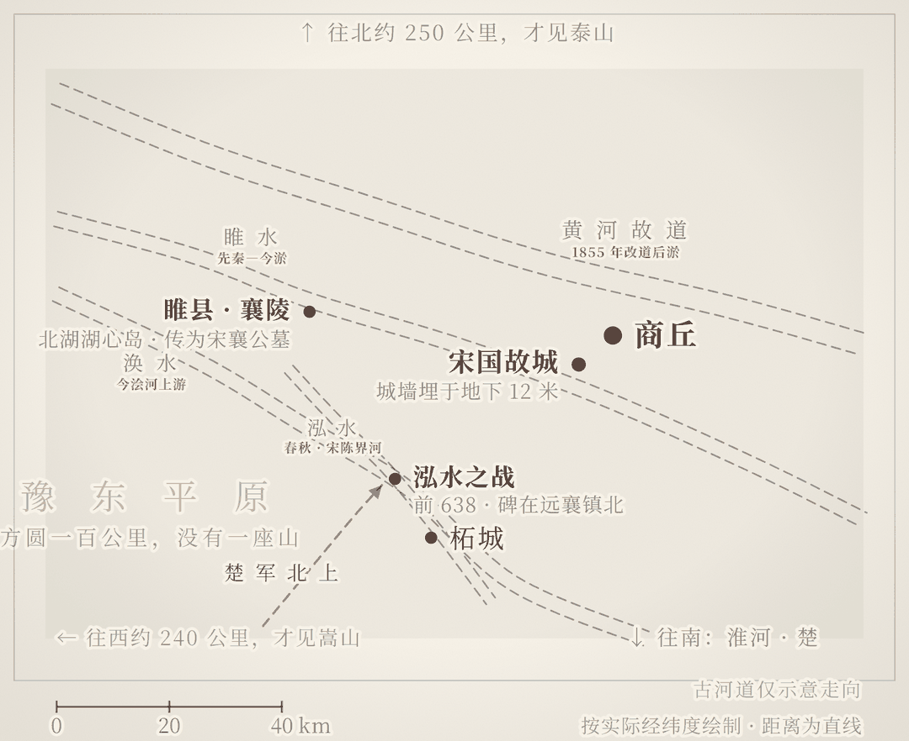

---
主题：一个爵位最高的国家，为什么把"礼"用成了笑话
覆盖地：商丘 / 睢县 / 柘城
地貌：平原（黄泛淤积）/ 无山可守 / 淮河支流横向水系
关键词：宋国, 宋襄公, 泓水之战, 宋襄之仁, 盂之会, 微子启, 宋国故城, 阏伯台, 三陵台, 微子祠, 襄陵, 望母台, 睢县北湖, 商丘博物馆
---

# 🏛️ 春秋爵位最高的国家，为什么输在一条河边？

> 公元前 1040 年前后，周公把商朝旧都那片地封给了纣王的庶兄微子启，国号宋，爵为公——五等诸侯里最高的那一等。
> 这个国家替前朝守了七百五十四年祭祀，也替中原守了七百多年的礼。
> 公元前 638 年冬天，宋襄公在泓水北岸等楚军渡河、等楚军列阵，然后被打断了腿。
> 一年后他死了。后人给这件事留下的词，叫"宋襄之仁"。

---

## 📖 一个问题：握着最高爵位的宋国，为什么把"礼"用成了笑话

周初分封，爵位是硬通货。公、侯、伯、子、男五等，宋国是第一等。这不是客气——周人灭了商，却必须留一个商，让殷商的祖先有人祭。于是纣王的庶兄微子启受封于商丘旧地，奉商祀，行殷礼，国君称公。**宋国不是普通的封国，它是一个被允许存在的前朝。**

它的都城在今天商丘古城西南，平面近似平行四边形，周长 12920 米，面积 10.5 平方公里——比你今天看到的明清归德府城大将近十倍。2006 年列第六批全国重点文物保护单位，2021 年起重启考古发掘，探方挖到 13 米深才见生土。从微子启到宋康王，宋国传 26 世 34 君，754 年。春秋十几个大国里，能活过七百年的没几个。

而且宋国不是一直弱。宋殇公、宋庄公那几十年，它是中原少数敢跟郑国正面掰手腕的国家；齐桓公死后齐国五公子争立，是宋襄公带着诸侯的兵把公子昭送回去，立为齐孝公——这是实打实的国际成绩。到战国末年，宋康王"东败齐，取五城；南败楚，取地三百里；西败魏军"，史称"五千乘之劲宋"。五千乘，在中原不算小。

但正是扶立齐孝公这件事，把宋襄公推错了方向。

公元前 643 年齐桓公死，五个儿子争位，齐国大乱。宋襄公联合卫、曹、邾的兵，把流亡在外的公子昭送回去，立为齐孝公。**一个公爵国，把霸主国家的君位定了下来——在他看来，这就是自己已经坐上主桌的证据。**

这件事能办成，靠的其实不是宋国的兵车：公子昭的几个弟弟力量分散，他本人在齐国有支持者，在国外又有以宋襄公为首的国际背书，于是很快赢了。宋国出的是名分，不是实力。**他把一次借来的成功，记成了自己的本钱。**

于是他想复制齐桓公：再召集一次会盟，再当一次盟主，打着"维护天下秩序"的旗号。他哥哥目夷劝他：兄弟，这事你得慎重——"小国争盟，祸也。"

可 754 年之后，公元前 286 年，齐、楚、魏三家联军把宋国分了。地被分，君被杀，连"宋"这个国号都没留给谁。而它留给后世最出名的一样东西，不是公爵的排场，也不是五千乘的兵车，是四个字。

宋襄之仁。

这里要先把宋襄公这个人摆正。他不是个只会说漂亮话的呆子：父亲病重时，他要把君位让给庶兄目夷，目夷不肯受；他会盟、平乱、扶立齐君，每一步都按规矩走。但《左传》同期还记了另一件事——公元前 641 年，他让邾人把鄫国国君杀了祭社。**同一个宋襄公，对阵前不肯击半渡的敌人，对小国国君却下得了手。** 这就不是"善良"或"迂腐"能解释的了。

于是这一趟要回答的问题，比"他蠢不蠢"难一点：**一个靠"礼"立国、也靠"礼"被诸侯尊重的国家，为什么最后把"礼"用成了一个笑话？**

那就去商丘吧。答案不在史书里，在老南关村北那片麦地下十二米。

---

## 🏞️ 你即将走的地貌：一片没有山的平原，把历史埋了十二米

商丘在豫东平原正中，海拔五十米上下，往东往南往北，一百公里内找不到一座山。地面上唯一的起伏是河堤和人工堆的土台——阏伯台就是其中之一，四千多年前的人一筐土一筐土地堆起来，因为这片平原上没有更高的地方可以看星星。

古代这里水不少：睢水从西往东，从宋国都城的南边流过——这座城那时叫"睢阳"，意思就是"睢水之北"；涣水、泓水这些淮河支流从西北斜向东南。但水是平的，不是险。**没有山，就没有关；没有关，就没有守。**

更糟的是黄河。南宋以后黄河一次次南泛，把豫东的地面一层层淤平——宋国故城的城墙底部，今天埋在距地表十二米的地方。你站在老南关的麦田里，脚底下的村路，比宋国人走的街高出十二米；那十二米，是黄河送来的。

一片无险可守、又不断被泥沙抹掉记性的平原，能靠什么立国？**只能靠信誉。** 宋国是前朝遗民之国，它的存在本身就是周人给天下看的一个姿态：我们不绝人祀。它守殷礼、讲信义、当缓冲，诸侯之间有事，愿意找它评理——这套东西听着像道德修养，其实是它的国防工事。

所以当南方的楚国带着另一套逻辑北上时，宋国遇到的不是一场战役，是一次失效：**它的城墙，是别人对它的信任；而楚成王不打算再给这份信任。**

你在商丘、睢县、柘城走的每一步，都踩在宋国人的头顶上，只不过隔了十二米黄土。

*图 1　宋国地貌示意图｜按实际经纬度绘制，距离为直线。四个河名都是虚线——它们今天都已经不在地面上了；古河道走向为示意，泓水地望存三说，图上取远襄一线。*

---

## 📖 虚实对照：出发前先弄清几件事

| 通行说法 | 正史与考古 | 判定 |
|---|---|---|
| 宋襄公是"春秋五霸"之一 | "五霸"名单自古不一，《史记》未列，《孟子》《荀子》《白虎通》各有版本，宋襄公只在部分版本里。他从未真正成为霸主：会盟被执，一战大败 | **存两说**：作为"说法"流传，作为"史实"不成立 |
| 扶立齐孝公，是宋国有实力的证明 | 公子昭的几个弟弟力量分散，他本人在齐国有支持者；宋国提供的是名分与国际背书，不是兵车 | **史实有据，因果被夸大** |
| 泓水之战输在"讲仁义" | 《左传·僖二十二年》确实记他不肯半渡而击、不肯击未成列；但宋楚的国力差距是根本原因。战后他对国人说"寡人虽亡国之余，不鼓不成列"——骨架是"我本可赢、我不忍心、敌人无底线" | **正史有据，但要分层**：记载为真，"因为仁义所以败"是他自己的说法 |
| 楚国恃强北上，打到了宋国家门口 | 同年三月郑伯如楚，夏"宋公伐郑"，楚人伐宋以救郑，战于泓。先出兵的是宋国 | **史实与通行叙述相反** |
| 两千多年来一直骂他蠢 | 相反。《公羊传》称"虽文王之战亦不过此"，《史记》说"君子或以为多……褒之也"。把"宋襄之仁"钉成贬义，是近现代的事 | **正史有据**（评价史本身有反转） |
| 宋国是个无足轻重的小国 | 宋是公爵国，春秋前期与郑争衡，战国末"五千乘之劲宋"，东败齐、南败楚、西败魏 | **民间印象，与史不符** |
| 宋襄公墓在睢县北湖湖心岛 | 明清《睢州志》即以襄陵为名胜，墓丘至今高约六米；但未经考古发掘确认，属传统认定 | **存疑**（传为原址） |
| 泓水在今天商丘城南 | 古泓水已被黄河淤平。位置有慈圣镇北、远襄镇北、惠济乡荣堂村三说，学界与地方文史界未统一 | **存三说** |

| 历史场景 | 今天能站在哪儿 | 性质 |
|---|---|---|
| 微子启受封的宋国都城 | 商丘·**宋国故城遗址**（睢阳区古宋街道老南关村北） | **考古原址，未开放**。2021 年起持续发掘，城墙夯土剖面已露出，工地不对外开放 |
| 宋国开国君主微子启 | 商丘·**微子祠**（睢阳区路河镇青岗寺村） | **复建建筑**。祠始建于唐，现存为 2002 年重修，院内有微子墓 |
| 宋戴公、武公、宣公三陵 | 商丘·**三陵台**（梁园区王楼乡宋大庄西北） | **考古原址＋新建殿宇**。三座陵台是原物，三公殿为 2008 年宗亲捐建 |
| 商丘得名之地、阏伯观星台 | 商丘·**阏伯台**（火神台） | **考古原址＋复建庙宇**。夯土台基四千余年，台上建筑为元明清 |
| 前 639 年盂之会，楚人执宋公 | 睢县·**蓼堤镇**一带 | **遗址已消失**。只剩地名与方志记载，无地面遗存 |
| 前 638 年泓水之战 | 柘城·**远襄镇北 / 惠济乡荣堂村** | **遗址已消失**。河道被黄河淤平，远襄镇北有保护碑，荣堂村有村办纪念馆 |
| 宋襄公葬地襄陵 | 睢县·**北湖襄园**湖心岛 | **传为原址，未经考古确认**。墓丘高约六米，旁边是望母台 |
| 商丘五千年通史 | 商丘·**商丘博物馆**（华商大道西段路北） | **博物馆**。免费，周一闭馆 |

八处现场，今天只剩三种状态：能进馆看到实物、能站在一块碑前、连碑都没有只剩一个地名。

这条线上的门票很便宜，贵的是路——四个点分布在商丘、睢县、柘城三个县区，没有车会很吃力。

---

## 🗓️ 三日沉浸式行程

### Day 1：商丘｜先弄清这个国家是谁的

这一天的路线是刻意安排的：先在博物馆建时间轴，再去看埋在十二米下的城墙，最后回到开国的那个人。**先知道国是谁建的，再看它埋在哪儿。**

**上午 · 商丘博物馆**（睢阳区华商大道西段路北）
—🎫 免费，凭身份证现场取票；团队须提前一周预约
—🕐 周二至周日 9:00-17:00，16:00 停止入馆，周一闭馆（法定节假日除外）
—✨ 必看：商丘五千年的地层序列（从龙山到明清）、宋国与汉梁的青铜与陶器。先把"商—宋—梁—归德"四个名字对应到四个时代，后面两天才不至于看到土堆就发懵
—💡 这座馆的价值不在器物，在顺序。商丘是少数能把"城摞城"讲成一条线的城市——你要看的不是某个展柜，是那条从商到宋到明的时间轴

**中午 · 商丘古城**（睢阳区中山大街）
—🎫 街区免费；登城墙约 30 元；南城门+张巡祠+应天书院联票 35 元，含火神台的大联票 59 元
—🕐 全天开放，城内小景点 8:00-18:00
—✨ 你站在归德府城的南城门上往西南看，视线越过城墙就是一片平麦地——那里是宋国都城的位置。**明清的商丘城，只占宋国都城的东北一角**，"城摞城"不是修辞，是这座城的建筑方式
—💡 先上城墙看这个比例，再去看遗址。不然你会以为"宋国故城"是个小土围子

**下午 · 宋国故城遗址**（睢阳区古宋街道老南关村北）
—🎫 无票、无门、不对外开放：这是正在发掘的考古工地
—🕐 白天在村外道路上远看，不要进围挡
—✨ 附近有两块保护碑：燧皇陵大门东侧一块，八关斋西墙外一块，上写"宋国故城·全国重点文物保护单位"。站在碑前往北看，是麦地和村庄；往下十二米，是东周城墙夯土、唐代墓葬、宋代睢阳城西墙——考古队的探方里，这些层叠在一起，最深挖到 13 米
—💡 这是全程最"什么都看不到"的一站，也是最重要的一站。**宋国的都城没有消失，它只是被埋在了十二米黄土下面。** 城墙保存高度 9.6 米，前前后后修补过二十多次，从东周到宋金，每一代人都在这道墙上加过土
—⚠️ 工地不开放。不要翻围挡、不要捡陶片、不要飞无人机；想看城墙剖面，回商丘博物馆看图与出土标本

**傍晚前 · 微子祠**（睢阳区路河镇青岗寺村，古城南约 15 公里）
—🎫 免费，不用预约；8:00-18:00
—🕐 1 小时够，全程无遮荫，夏天别正午来
—✨ 三进院落：微子祠、先贤堂、微子墓。祠始建于唐天宝年间，历代毁修，现存为 2002 年印尼华侨宋良浩捐资四百余万元重修。碑上记着宋国的账：前 1040 年开国，前 286 年亡，26 世 34 君，754 年
—💡 这是全程唯一一个"宋"字还活着的地方——天下宋姓的族谱从这里起头。但要分清：**祠是复建的，墓是传统认定的**，唐代的祠早就没了，你看到的是最近二十年的砖
—⚠️ 小众景点，偶尔锁门；门框上一般留着管理员电话，打个电话几分钟就来开

**傍晚 · 阏伯台（火神台）**（睢阳区平原路与华商大道交叉口东）
—🎫 30 元（庙会期间另有优惠票）；夏季 8:00-18:00，冬季 8:00-17:30
—🕐 建议 16:30 前后到，光线斜，台上能看遍整片平原
—✨ 一座人工夯起来的土台，台上是元代所建、明清重修的阏伯庙。阏伯是商族始祖契，传说在这里观测大火星（心宿二）定农时，死后葬于台下——"商丘"这个名字，就从他封号里的"商"来
—💡 这一站解释了一件事：宋国为什么非把都城建在这里。**商丘不是随便一块平原，是商族的老家。** 微子封宋，封的不是新地，是祖先的旧土。宋国人守的不只是一个国，是一个被周人允许存在的前朝

---

### Day 2：商丘→睢县｜从主桌，到湖心岛

这一天的路线是一条下坠的线：上午看宋国国君的陵，中午去他们争盟主的地方，下午到宋襄公葬身的湖心岛。

**上午 · 三陵台**（梁园区王楼乡宋大庄西北，古宋河南岸）
—🎫 免费（部分平台标 10 元，现场以公告为准）；全天开放，8:00-18:00 之间去稳妥
—🕐 1-1.5 小时
—✨ 三座土陵东西并峙，台上及周围有四百多棵古柏，部分树龄八百年到一千年。三公殿里供的是宋戴公、宋武公、宋宣公——宋国第 11、12、13 代国君，公元前 8 世纪的人。2000 年列为省级文保，2013 年升为全国重点文保
—💡 站在这三座陵中间往南看：九公里外就是宋国都城遗址，方位在城的西北乾位。周代诸侯国君葬在都城北郊的公墓区，这个方位对得上，等于给"三陵台是宋国君陵"这个老说法补了一个旁证。**它不是三个景点，是一张家族墓地**：戴、武、宣、牛、皇甫、孔……两百多个姓从这三座土堆里分出去
—⚠️ 台上有石像生和碑刻，不要摸、不要攀爬

**中午 · 蓼堤镇**（睢县西北）
—🎫 无
—✨ 公元前 639 年秋，宋襄公以盟主身份，约楚成王与陈、蔡、郑、许、曹会于盂。盂的地望，地方文史界定在今睢县西北蓼堤镇一带。今天这里是一片普通的镇子，没有碑，没有台，没有任何东西提醒你这里发生过什么
—✨ 会盟的第一件事是排座。按周礼，宋是公爵、楚是子爵，宋国该坐首席；可这一年管用的不是爵位，是兵车。宋国是百公斤级的选手，齐国、楚国是三四百公斤级的选手——一个百公斤级的人非要坐到三四百公斤级的前面，会发生什么？齐孝公是宋襄公扶上台的，看他坐前面，不高兴，但不好意思计较；楚成王没有这个顾虑，当场就让人把宋襄公抓了。《左传》只记了结果——"楚人执宋公以伐宋"，没记会上争了什么；座次是后人替这场会盟补出的解释，但补得很像那么回事
—💡 这一站的意义就是"什么都没有"。**宋襄公的霸业，在地面上没留下一块砖。** 他以为自己在上演齐桓公的会盟，其实他连会场的安全都保不住。他轻车简从赴会，本意是用"不带兵"换诸侯的信任——不带兵是他的诚意，也是他唯一拿得出的东西。楚人扣了他，迫于诸侯压力很快又放了，可"盟主被从会场上绑走"这件事，收不回来
—⚠️ 无地面遗存，别按导航找"盂之会遗址"，找不到

**下午 · 睢县北湖 · 襄园**（睢县城北）
—🎫 免费，全天开放
—🕐 2-3 小时，日落前最好
—✨ 你面前这片水，是宋至清初的睢州旧城——黄河淹了城，城变成湖，水面 268 公顷，南北长 1880 米。湖心岛上有两样东西：望母台和襄陵。望母台传为宋襄公为母亲所筑：他母亲是卫国女，生他之后被遣归卫，《诗经·卫风·河广》"谁谓河广？一苇杭之"据说就是这位母亲的口吻。台在湖心，他站在台上往西北望，望的是黄河那边的卫国
—✨ 台边的土丘就是襄陵，高约六米。泓水伤股之后他不回都城，来到离母亲故乡更近的襄邑养伤，第二年五月死在这里，葬在这里。睢县古称"襄邑"，就是因这座陵得名
—💡 全程反差最大的一幕在这里：一个因为"仁义"被嘲笑了两千六百年的人，留在地面上的唯一建筑，是一座为母亲筑的望台。**他的悲剧不是假仁义，是真仁义用错了地方**——对母亲讲孝、对诸侯讲信、对敌人讲礼，三件事在他心里是一件；而在楚成王那里，一件都不算
—💡 顺带看一眼湖：湖底是完整的明清睢州城。你在湖边吃的那条鱼，游在一座城的屋顶上

**傍晚 · 睢县博物馆**（襄园院内）
—🎫 免费；周二至周日 8:30-18:00，周一闭馆
—🕐 半小时
—✨ 历史、精品、石刻三个展区，182 件藏品，不大。值得看的是那些从旧城里捞出来的东西

**晚**：宿睢县。北湖夜里有灯，湖中路散步很好。

---

### Day 3：柘城｜回到泓水，看那两次机会是怎么被放弃的

这一天是倒叙。前一天你已经看到了结局——他葬在湖心岛。这一天往回走一年，到他挨那一箭的地方。

先记住一件事：泓水不是楚国打上门来的。公元前 638 年，宋襄公出兵伐郑——郑伯亲楚，他就去打郑；楚成王发兵救郑，两军才在泓水撞上。**盂地被绑的账没算清，他转头去找一个软一点的对手出气，结果把硬的招来了。**

**上午 · 泓水之战古战场保护碑**（柘城县远襄镇政府北，柘宁公路旁）
—🎫 无
—✨ 一块碑，立在公路边。往四周看：一马平川，没有河，没有沟，没有坡。古泓水是宋与陈的界河，从西北流向东南，北宋以后被黄河一次次淤平，河床已成平地。文献里那条河，今天只剩一个名字
—💡 这是全程唯一一个"站在战场上却看不见战场"的地方，也是最值得站一会儿的地方。公元前 638 年十一月初一，楚军从南岸下水；宋军已在北岸列好阵；大司马公孙固说，半渡而击。宋襄公说，不可。楚军上岸，还没排好队；公孙固又说，现在打。宋襄公说，不可。等楚军列完阵，宋襄公击鼓。**《左传》只用了几个字：宋师败绩，公伤股，门官歼焉**
—✨ 战后——败回都城，宋襄公对国人做了一次复盘。史书留下的原话很克制，只有一句："寡人虽亡国之余，不鼓不成列。"意思是：我虽是亡国者的后代，也不去打没有列好阵的军队。**这是解释，不是检讨**——它把"打输了"翻译成了"我没肯那么打"
—✨ 后世说书人把这一句演成了一整套托词：我本可以趁楚军立足未稳，一个劈空掌把他打翻在地，可那样胜之不武；我一掌拍到他鼻梁上，只要再加一分力，他就脑浆崩裂，可我觉得太残忍，收了手；没想到他不领情，反手一脚踢在我裆上，我才倒地的。**你们不要看我倒在地上，就以为我武功不如他——其实我比他高三个段位。** 一个绝顶高手，把武德和江湖道义看得比性命还重；再来一次，我还这么干
—⚠️ 碑在公路边，注意来往车辆；四周是农田，不要踩庄稼

**上午 · 荣堂村泓水之战纪念馆**（柘城县惠济乡荣堂村委南侧）
—🎫 免费；村办展馆，开放不固定，最好提前联系村委
—✨ 一间屋子：作战沙盘、地图、文字、图片。村西北角有县文物部门挖的土层断面，下部是泓水流域的沙土层——村民说这一带挖不成红薯窖，一挖就塌，因为地下十米全是沙。沙是河的遗骨
—💡 一个村子给一场战争建了纪念馆，这件事本身比展品有意思：**泓水之战在正史里是一个转折点，在当地是一个村的来历。** 地方文史界至今有三种说法（慈圣镇北、远襄镇北、荣堂村），你站的这片沙土是其中一种，不是定论
—⚠️ 不要自己去挖土、翻找"遗物"

**中午 · 柘城县城 · 容湖**
—🎫 免费
—✨ 容湖是柘城的北湖，1.76 平方公里，环湖八公里栈道。西侧有一段夯土残墙，是柘城故城的城墙，战国到汉的，不属于宋国，但它证明这一带在那个年代就是城
—💡 在湖边吃顿饭再走。这一带的土是沙土，种不好麦子，却极适合辣椒——今天柘城是"中国三樱椒之都"，年交易量几十万吨。**泓水河床淤成的那片沙地，两千六百年后养活了另一种红色的东西**

**下午 · 柘城县博物馆**
—🎫 免费；9:00-17:00，周一闭馆
—🕐 半小时
—✨ 龙山、夏商文物，当地出土
—💡 如果只能选一个室内点收尾，选它：看完麦田里的碑，再看柜子里的陶片，你会明白考古是怎么把"没有"变成"有"的

**返程**：柘城回商丘约 56 公里，一小时。

---

## 🎭 一套用了两千六百年的说法

泓水之后，宋襄公死了，这套说法活了下来。

它的骨架很短，四句话：我本来能赢；我不忍心；敌人没有底线；再来一次我还这么干。

第三句最能生枝。最经典的桥段是这样说的：我军本来可以一举全歼，只因敌人驱赶无辜百姓冲在最前面，当人肉盾牌、当人肉开路机，我军纵然神功无敌，也无处施展。

这套话听多了，人会起一种反应。二十世纪的战报里，同样的语法反复出现：退下来的那一方很少说"我们打不过"，多半说"敌人不守规矩"。这不是哪一支军队的毛病，是所有输不起的人共用的语法——**先把失败翻译成道德，再让道德替失败挡一挡。**

当时的听众没那么客气。他们听完的结论是：你挨打，活该。就这种迂腐的脑袋，武功再高，也挡不住一菜刀。

于是成语词典里多了一个词条：宋襄之仁。

而最讽刺的地方在这里：让宋襄公名垂青史的，绝不是他作为"春秋五霸之一"的身份，而是"宋襄之仁"这四个字。**一个人被记住的方式，往往和他想被记住的方式相反。**

---

## 🍜 风物彩蛋（吃出穿越感）

- **北湖鱼**：睢县北湖的鱼，湖底是被黄河淹掉的睢州旧城。一锅糟鱼端上来，你吃的是在一座城屋顶上游过的东西——这话不好听，但是事实
- **柘城辣椒**：三樱椒，整县种，红得发亮。它长在泓水河床淤出的沙土里——沙土排水快、昼夜温差大，辣椒才够辣。一场战争的地理后果，最后落在了一盘菜上
- **归德老三样**（黏面馍、豌豆糕、砂糖馅）：商丘古城中山大街的早点，三代非遗。宋国是商遗民，商人会做买卖也会做甜食；这三样的共同点是耐放、便携——赶路的人吃的，不是坐堂的人吃的

---

## 💡 实用贴士

1. **最佳季节**：4-5 月、9-11 月。夏天豫东平原湿热，田野无遮蔽；冬天麦田灰黄，遗址更难看出所以然
2. **交通**：高铁到**商丘站**（郑徐、商合杭），站前打车到古城约 15 元。三个县区分散——商丘市区到睢县约 60-80 公里、70-80 分钟；睢县到柘城远襄约 30 公里；柘城回商丘约 56 公里。**强烈建议自驾或包车**。商丘 303 汽车站有到柘城的城际公交（10-13 元，20 分钟一班），到睢县也有班车，但到了县城之后，去蓼堤、远襄、荣堂这些镇村点，公交基本靠不上
3. **闭馆日**：商丘博物馆、睢县博物馆、柘城县博物馆**都是周一闭馆**（法定节假日除外），行程不要排周一
4. **预约**：商丘博物馆免费但需现场取票（身份证），团队提前一周电话预约；其余各馆免费直接进
5. **避坑**：宋国故城是考古工地，**没门、没票、不开放**，只能在外面看保护碑；盂之会旧地连碑都没有；泓水的河已经没了，不要按导航找"泓水河"
6. **装备**：麦田边土路多，穿防滑鞋；遗址区无遮蔽，带水和帽子；夏秋蚊虫多
7. **参观礼仪**：三陵台的石像生、微子祠的碑刻不要触摸；墓葬区不用闪光灯；农田不要踩

---

## 🎯 站在泓水北岸

你站在远襄镇北的公路边。碑在身后，河在地下。

脚下这片平得没有起伏的麦地，两千六百多年前有水。水两边站着两支军队。北岸的人等着对面的人上岸、排队、站好，然后才敲鼓。他等的那套规矩，是商周几百年攒下来的：结日定地、各居一面、鸣鼓而战、不相诈。这套规矩在他祖父那一辈还算数，到他这一辈，南边来的人不认了。

楚国不是不懂礼，是不需要礼。它被中原叫作"蛮夷"叫了几百年，正因为被排除在外，它可以不守场上的规矩，直接掀桌子。宋襄公输的不是道德，是判断——他以为所有对手都还在同一张棋盘上。

> 宋国不是输在讲礼，是输在把礼当成了兵。
> 礼是弱国的护城河：它让一个没有山川的国家，靠信誉活了七百年。
> 但护城河挡不住洪水。对手换了一套规则，你守的每一条规矩，都会变成对方的便利。

他死后，宋国又活了三百多年，还打过几场漂亮仗。只是再没有人提过"霸主"两个字。

**他守住了礼，礼没有守住他。**

他一生都在算计自己该坐哪一排。历史最后给他排的座，是他最不想坐的那个。

---

**资料来源**：《左传·僖公十九年、二十一年、二十二年》《史记·宋微子世家》《公羊传·僖公二十二年》《诗经·卫风·河广》毛诗序；商丘博物馆参观须知（2024-03）；宋国故城考古发掘公开报道（《河南日报》2023-05、商丘日报 2025-04）；商丘日报《襄园沧桑话襄公》（2020-06）；柘城县文史资料《泓水之战》（2021-07）；睢县北湖景区公开信息

*票价与开放时间整理自公开信息（截至 2026-11），出行前请以景区官方公告为准。*

读万卷书 · 行万里路
