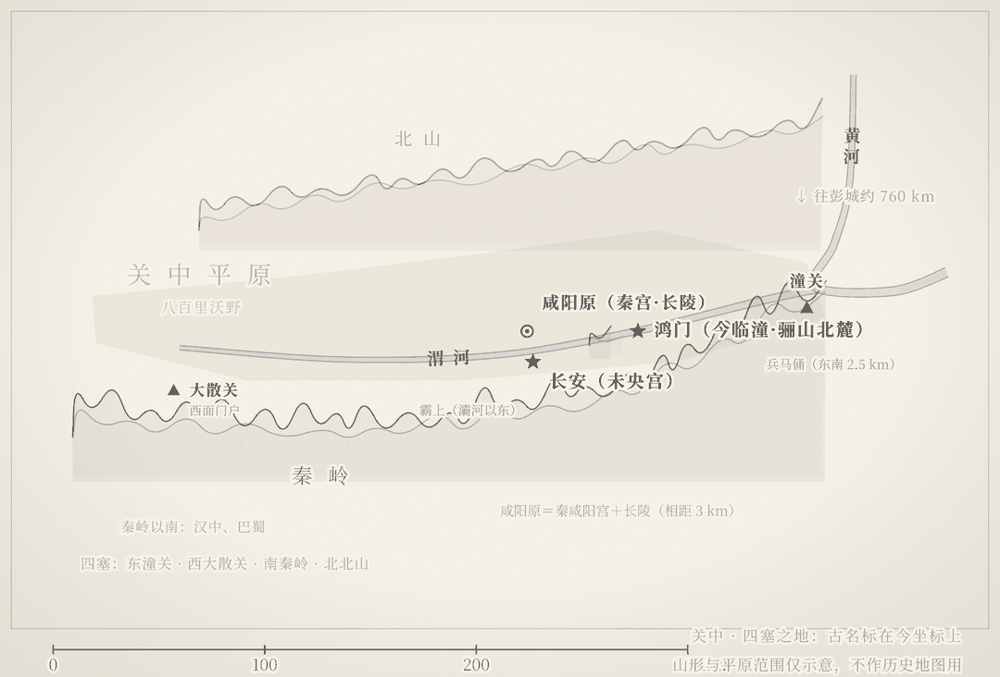

---
主题：项羽赢下了每一场战役，为什么输掉了整个天下
覆盖地：临潼 / 咸阳 / 西安
关键词：楚汉, 鸿门宴, 项羽, 刘邦, 鸿门宴博物馆, 项王营, 兵马俑, 秦咸阳宫遗址, 长陵, 未央宫, 汉长安城, 关中
---

# ⚔️ 每一场战役都赢了，项羽为什么输掉了天下？

> 公元前 207 年岁末，项羽四十万大军压在鸿门，刘邦十万人在霸上，一场宴会决定了谁先进咸阳。
> 项羽此后八年「身七十余战，所当者破，所击者服，未尝败北」——他到死都没想明白自己输在哪。
> 而四年后垓下一战，天下姓了刘。
> 答案不在垓下，在关中：他亲手扔掉的那片地，就是对手赢的资本。

---

## 📖 一个问题：未尝败北的人，是怎么输光天下的

先看牌面。巨鹿之战后，项羽是什么地位？**诸侯将相"膝行而前，莫敢仰视"**——进辕门的那一段路，各路诸侯将领是跪着爬过去的。破釜沉舟、九战九捷，秦军主力是被他打垮的；鸿门宴那年他二十八岁，手握天下最强的军队，分封十八路诸侯，自封"西楚霸王"，这个天下是他说了算的。

他也不是没有兑现过。军事上，从巨鹿到彭城，他几乎没有输过：彭城之战，刘邦率五十六万联军攻占彭城，项羽带三万精兵回师，半天打崩五十六万人，"睢水为之不流"。史书里找不出第二个人，能把劣势打成这样。

可结局是：**前 202 年，项羽兵败垓下，自刎乌江，三十一岁。**赢下他一生绝大多数战斗的人，最后连整块地盘都没保住；被他在鸿门宴上放走、在彭城打得只剩几十骑的刘邦，成了汉高祖。

一种很有解释力的说法是：**历史评价是倒着写的**。鸿门宴上项羽放走刘邦，如果刘邦后来输了，那就是一段"项王重义"的佳话；刘邦赢了，同一件事就成了"妇人之仁、毫无政治头脑"的铁证。同一决定，两种定性——差别的根源不在决定本身，而在决定之后那四年各自做对了什么、做错了什么。

这趟关中之行要回答的就是：**项羽到底是在哪一步，把这场必胜的局一步步让出去的？**

那就去西安吧——答案埋在临潼到咸阳的三十公里土里。

---

## 🏞️ 你即将走的地貌：被山带河的四塞之地

关中平原的格局一眼可辨：**南边是秦岭，北边是北山，渭河从两山之间缓缓东流，冲出一片八百里沃野**。东出只有潼关一条路，西面卡着大散关，南面是翻不过去的秦岭——所谓"四塞之国"，进可攻、退可守，守着一扇门就能关起门过日子。

这片地有两样别处凑不齐的东西：**肥得能养百万人口的耕地，和一条直通黄河的水运**。战国时"天府之国"这个词，最早说的就是关中，不是四川。

于是规则从第一天就定了：**得关中者得天下**。秦始皇靠它扫平六国，刘邦先进关中、约法三章收尽人心，后来与项羽争天下，兵员、粮食、退路全从这片平原里出。而项羽分封之后，把这片地分给了三个秦朝降将，自己带兵东归彭城——有人劝他定都咸阳，他回了那句著名的话："富贵不归故乡，如衣绣夜行。"

你站在骊山北麓的鸿门原上，脚下这块被渭河和骊山夹住的台地，就是项羽亲手让出去的那张底牌。

---

## 📖 虚实对照：出发前先弄清三件事

| 演义/印象 | 正史与考古 |
|---|---|
| 项羽在鸿门宴上"一时心软"放走刘邦 | 项羽当时的头号对手不是刘邦，是"自己人分赃不均"的风险；放走刘邦是否符合他的政治盘算，学界至今有争论——"妇人之仁"是胜负揭晓后的追认 |
| 兵马俑坑是项羽烧的，板上钉钉 | 一号、二号坑确有焚毁痕迹，焚烧原因学界存两说（项羽军所焚说是主流之一，但也有自燃等观点），导游的"定论"要打折听 |
| 项羽烧的是阿房宫 | 《史记》原文是"烧秦宫室，火三月不灭"，未点名阿房宫；考古发掘显示阿房宫前殿当时**尚未建成**，也没有发现火烧痕迹——烧的是咸阳宫一带 |
| 刘邦是靠运气的无赖 | 刘邦入关中"财物无所取，妇女无所幸"、约法三章，范增当时就看穿"其志不在小"；后来定都关中、重建秩序，每一步都是选择 |

| 历史场景 | 今天能站在哪儿 | 到了会看到什么 |
|---|---|---|
| 鸿门宴现场：项庄舞剑、樊哙闯帐 | 临潼·鸿门宴博物馆（新丰街道鸿门堡村） | **考古原址＋复建场景**。宴台原址高地、霸王沟尚存，仿古军帐与雕塑群是后建的；出土刻有"鸿门坂"三字的汉代方石 |
| 秦帝国的家底：地下军团 | 临潼·秦始皇帝陵博物院（兵马俑） | **考古原址＋博物馆**。一号坑可见明显焚烧黑迹，成因存两说——这正是"项羽烧秦"传说的现场 |
| 项羽纵火之地：秦咸阳宫 | 咸阳·秦咸阳宫遗址博物馆（窑店街道） | **考古原址＋博物馆**。一至三号宫殿基址出土大量红烧土与炭迹，与"火三月不灭"的记载对得上 |
| 赢家的陵墓：汉长陵 | 咸阳·长陵（窑店街道三义村北） | **考古原址（田野）**。刘邦与吕后两座覆斗形封土东西并立，无门票、无围挡景区，封土外围可绕行 |
| 赢家的都城：未央宫 | 西安·汉长安城未央宫国家考古遗址公园 | **考古原址（公园）**。前殿、椒房殿夯土基址连绵铺开，面积远超想象；刘邦当年嫌它修得太奢侈 |

---

## 🗓️ 两日沉浸式行程

### Day 1：临潼｜宴会那晚，项羽站在巅峰

**上午 · 鸿门宴博物馆**（临潼区新丰街道鸿门宴路 2 号，距兵马俑约 2.5 公里）
—🎫 旺季（3 月 1 日至 11 月 30 日）成人 40 元、学生 20 元；无需预约，现场购票
—🕐 8:30-17:30；建议 9 点开门就进，赶在旅行团之前
—✨ 必看：**宴台原址高地**——鸿门是骊山北麓一条一公里长的峭塬，中间如刀劈开、南北洞开，"鸿门"因此得名，这个地形今天还能看出来；**"鸿门坂"汉代刻石**，遗址身份的实证；馆内三大展厅按"楚汉对峙—宴会全过程—项羽结局"排布，下午两点左右有约 20 分钟主题演出（以当日公告为准）
—💡 站在宴台上往北看：渭河在两三公里外，霸上在河对岸更远处。当年刘邦从这里脱身，是骑马沿渭河南岸向西南跑回霸上四十里——你能看懂这条逃命路线为什么走得通。**鸿门宴真正的输家，那天其实一个都没输**

**下午 · 秦始皇帝陵博物院**（临潼区秦陵北路，含丽山园，两园间免费摆渡）
—🎫 120 元（含丽山园），**实名制预约**，官网或官方微信公众号购票；旺季（3 月 16 日至 11 月 15 日）8:30-17:00 停止入园、18:30 闭馆
—🕐 建议下午 1 点入馆，先看一号坑，约 3 小时
—✨ 必看：一号坑**中后段北壁的黑色炭迹与过洞焚毁痕迹**——俑坑曾被大火烧过是确凿的；三号坑的指挥部格局；丽山园的铜车马
—💡 导游会告诉你"这是项羽烧的"——这确实是主流说法之一，但学界存两说。你要看的不是"谁放的火"，而是这个地下军团本身：**这就是项羽和刘邦抢的那个家底**。项羽拿到它，用它分封；刘邦拿到它，用它建立汉朝
—⚠️ 展厅内禁用闪光灯；节假日人流极大，务必提前预约

---

### Day 2：咸阳到长安｜从项羽烧掉的，到刘邦赢走的

这一天的路线是刻意安排的：**上午看项羽烧掉的宫，下午看刘邦的陵和他的都城**。从火场走到赢家头顶上，路线自己会把话说完。

**上午 · 秦咸阳宫遗址博物馆**（咸阳市渭城区窑店街道牛羊村北）
—🎫 免费，刷身份证入馆，无需预约；**每周二闭馆**
—🕐 9:30-17:00（16:30 停止入馆）；建议开馆即到，约 1.5 小时
—✨ 必看："大秦中枢·六合一统"常设展（74 件组文物）；出馆步行可达**一、二、三号宫殿基址**——考古发掘出大量红烧土、木炭残迹，与《史记》"烧秦宫室，火三月不灭"互为印证
—💡 这是全篇最刺眼的一站：**项羽烧掉的不只是一座宫，是他自己不要的奖赏**。定都这里，他就是第二个秦始皇；他选择烧掉它、回彭城，等于宣布自己只想做旧秩序里最大的一个王。火光冲天的那一刻，胜负已经转向
—⚠️ 遗址区无遮蔽，夏季暴晒；基址土台请勿攀爬

**下午 · 长陵**（咸阳渭城区窑店街道三义村北，距咸阳宫遗址约 5 公里）
—🎫 免费，无门票、无正式景区，全年可到
—🕐 建议停留 40 分钟至 1 小时
—✨ 必看：**刘邦与吕后两座东西并立的覆斗形封土**，高三十余米，立在咸阳原上极醒目；东侧数公里的陪葬墓群——萧何、曹参、周勃等开国功臣陪着他们的皇帝
—💡 两个细节值得咀嚼：其一，长陵选址就在秦咸阳宫旧址一带，**刘邦把都城和陵墓都压在项羽烧过的废墟上**——他要让所有人看见谁接住了天下；其二，刘邦称帝第二年就开始修陵，而项羽至死没有自己的陵墓。**胜负在开工时间上已经写明**
—⚠️ 全国重点文保，封土与陪葬墓**严禁攀爬**，只在保护围栏外看

**傍晚 · 汉长安城未央宫国家考古遗址公园**（西安市未央区邓六路）
—🎫 免费，无需预约
—🕐 6:00-22:00；傍晚光线最好，建议日落前两小时进入
—✨ 必看：**前殿遗址**——未央宫的主殿基址，现存夯土台东西约两百米，站在上面能体会"非壮丽无以重威"是什么尺度；椒房殿、天禄阁、石渠阁基址散布在公园各处
—💡 未央宫是萧何监造的。建成时刘邦看见宫室壮丽，发了火："天下匈匈苦战数岁，成败未可知，是何治宫室过度也！"萧何答："天子以四海为家，非壮丽无以重威。"**这一问一答，就是项羽和刘邦的差距**：一个用战争回答问题，一个已经学会用秩序回答问题。汉家四百年，从这座台基上开始
—⚠️ 公园极大，步行成本高，园内代步车另收费；周边餐饮配套少，自备水和干粮

---

## 🍜 风物彩蛋

- **临潼石榴**：张骞通西域后沿丝路传入的物种——丝路的起点正是未央宫，你在终点站吃的果子，是这条路线两千年前的回声
- **锅盔**：关中厚饼，民间相传源于秦军行军干粮，耐存放、顶饿——项羽和刘邦抢天下时，秦人吃的还是这一口
- **火晶柿子**：骊山脚下的时令果，十月底起上市，十一月正当季；临潼人做柿子饼，是冬天的开始

---

## 💡 实用贴士

1. **最佳季节**：10 月中旬至 11 月中旬。秋天关中天高气爽，未央宫的粉黛乱子草正开，临潼柿子石榴当季；夏季平原暴晒，遗址区无遮蔽，非常吃体力
2. **交通**：高铁到西安北站。Day 1 乘地铁 9 号线至秦陵西站，转 617 路、301 路或临渭专线到鸿门宴博物馆，兵马俑与鸿门宴相距仅 2.5 公里；Day 2 窑店街道各点公交班次少（地铁 14 号线秦宫站转副 840 可到咸阳宫遗址博物馆），**强烈建议自驾或包车**，长陵到未央宫约 25 公里需跨渭河
3. **闭馆日**：Day 2 的秦咸阳宫遗址博物馆**每周二闭馆**，行程务必避开周二；Day 1 的兵马俑、鸿门宴全年开放
4. **预约**：兵马俑必须实名预约，旺季尤其节假日提前数日抢票；鸿门宴、咸阳宫遗址博物馆、未央宫、长陵均无需预约
5. **避坑**：长陵是田野原址，没有门、没有票、没有游客中心，导航"长陵"到三义村北即见封土；别把它当成景区，更别爬封土
6. **装备**：Day 2 全天在遗址区和田野，穿防滑鞋，带足饮用水
7. **参观礼仪**：俑坑、长陵封土均为不可移动文物，禁闪光灯、禁攀爬、勿拾取陶片

---

## 🎯 站在未央宫前殿遗址上

台基比你想的高，走上去要爬一段缓坡。

脚下这片夯土，刘邦站过，吕后站过，萧何站过。往南越过渭河，是项羽烧掉的咸阳宫废墟；往北三十公里，是他自己长眠的长陵。**同一条渭河，隔开了楚和汉两个朝代的命运。**

项羽不是败给哪一场战役。他七十余战全胜，却把最值钱的三样东西一件件扔了：鸿门宴上扔掉了对手的性命，咸阳的火里扔掉了帝国的都城，分封之后扔掉了关中这片四塞之地。刘邦做的恰恰相反——他几乎每一场都在输，但关中、人心、秩序，他拿到手的一样没还回去。

> 项羽的失败，不是一个将军的失败，是一个"胜利者"的失败。
> 他始终在打上一步棋，而天下已经被移到了下一步。

**未尝败北的人，输给了他不要的那些东西。**

---

**资料来源**：《史记·项羽本纪》《史记·高祖本纪》；秦始皇帝陵博物院官网（bmy.com.cn，2026-11）；鸿门宴博物馆旺季票价公告（临潼区人民政府，2026-03）；秦咸阳宫遗址博物馆参观须知（2026-08）；西安发布·汉长安城未央宫遗址公园信息（2026-10）；央视纪录片《西汉帝陵》

*票价与开放时间整理自公开信息（截至 2026-11），出行前请以景区官方公告为准。*

读万卷书 · 行万里路
